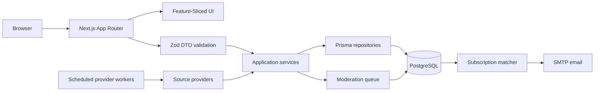
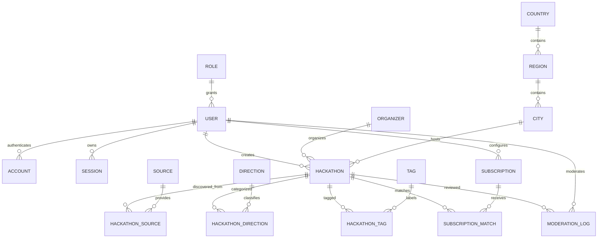

# HackTeen: architecture and delivery plan

## Product and system boundaries

HackTeen is a Russian-language, mobile-first directory of current hackathons and IT competitions for participants under 18. The first launch prioritizes Barnaul and Altai Krai, followed by Russian online events and international online events. Public pages are optimized for search engines; registration always points to the organizer's original page.

The application is a Next.js 15 App Router modular monolith. PostgreSQL is the source of truth. Public pages use React Server Components and server-side Prisma queries; interactive search/filter controls and subscription forms are small Client Components. Route Handlers expose validated JSON DTOs to external clients and future integrations. This avoids an unnecessary network hop for the first-party pages while keeping a stable API boundary.

## Architecture decisions

| Concern | Decision |
|---|---|
| Web/API | Next.js 15 App Router, TypeScript, Route Handlers |
| UI | Tailwind CSS, accessible in-house primitives following shadcn/ui conventions |
| Client state | URL search params for shareable filters; Zustand only for ephemeral client state |
| Server cache | React Query is available for interactive API-backed features; public directory pages remain server rendered |
| Persistence | PostgreSQL + Prisma; normalized region, city, organizer, direction, tag, role and source relations |
| Search | PostgreSQL `websearch_to_tsquery` / `ts_rank` with Russian and English dictionaries and a GIN expression index |
| Validation | Zod at every external input boundary; explicit query DTOs and mutation DTOs |
| Authentication | Auth.js / NextAuth with database adapter; authorization is enforced by server-side role checks |
| Aggregation | Node.js provider contract, Yandex Search API queries plus one adapter per source; source records are deduplicated and enter moderation before publication |
| Email | SMTP adapter; subscriptions match age, direction and format; delivery failures are logged and retryable |
| Deployment | Docker Compose for Next.js and PostgreSQL; environment-based secrets, no credentials committed |

### Request/data flow



Public content is visible only after moderation (`PUBLISHED`) and while the event end date has not passed. Scraped input is retained with source provenance and review status; it is not treated as trusted HTML.

## Feature-Sliced Design boundaries

Next route segments live in `src/app`. Reusable domain and application code follows FSD layers:

- `src/entities`: hackathon, direction, subscription, user and organizer domain types, schemas and UI.
- `src/features`: search/filter, subscription, admin moderation and event management user actions.
- `src/widgets`: composed page blocks such as the header, hero, directory, category strip and footer.
- `src/shared`: Prisma client, DTOs, validation, UI primitives, configuration and common utilities.
- `src/server`: application services, authorization, mail and provider orchestration. Server-only code must not be imported by client modules.

Dependencies flow inward from `app`/`widgets`/`features` to `entities` and `shared`; server services are imported only from server components and Route Handlers. Each feature exposes its public API through `index.ts` where useful.

## Project structure

```text
src/
  app/
    (public)/page.tsx
    (public)/hackathons/[slug]/page.tsx
    (public)/subscribe/page.tsx
    admin/page.tsx
    api/hackathons/route.ts
    api/hackathons/[id]/route.ts
    api/subscriptions/route.ts
    api/auth/[...nextauth]/route.ts
    layout.tsx
    globals.css
    sitemap.ts
    robots.ts
  entities/{hackathon,direction,subscription,user,organizer}/
  features/{hackathon-search,subscription,admin-hackathon}/
  widgets/{site-header,hero,directory,category-strip,site-footer}/
  shared/{api,config,lib,ui}/
  server/{auth,mail,services,providers}/
prisma/
  schema.prisma
  seed.ts
docs/
  architecture.md
docker-compose.yml
Dockerfile
```

The existing Python parser is retained under `backend/` during migration so its source adapters and data are not discarded. New provider implementations belong in `src/server/providers`; migration of the old scraper is a separate, testable workstream.

## ERD



`Role`, `Country`, `Region`, `City`, `Direction`, `Source`, `Organizer` and `Tag` are reference/domain entities. Join tables preserve many-to-many relations and source-specific provenance. A subscription may be anonymous (email-only) or linked to an account; delivery state is recorded per matching event to make notifications idempotent.

## Delivery roadmap

1. **Foundation (this implementation):** App Router migration, responsive directory/search, event details, subscription intake, validated APIs, normalized Prisma schema, seed data, Docker, metadata and source-provider contracts.
2. **Trust and operations:** configure production Postgres/Auth.js/SMTP secrets, role provisioning, admin create/edit/archive and moderation UX, audit trail, provider run history, retryable email outbox, monitoring and rate limits.
3. **Aggregation quality:** implement and verify source-specific APIs/HTML adapters, legal/robots checks, canonical URL deduplication, confidence scoring, stale-event expiry and moderator review.
4. **Launch hardening:** accessibility and responsive QA, Russian/English search relevance tuning, SEO verification, integration/E2E tests, backup/restore drills, security review and production deployment.

No scraped result is presented as current until it has valid event dates and is published. Provider credentials and SMTP settings are deployment secrets and must be configured outside source control.

The Compose parser worker runs immediately at startup and then daily at the configured local time (`PARSER_TIMEZONE`, default `Asia/Barnaul`). Search-result snippets are discovery leads, not verified event records: unknown ages, dates, eligibility and formats must be completed by moderators before publication.
